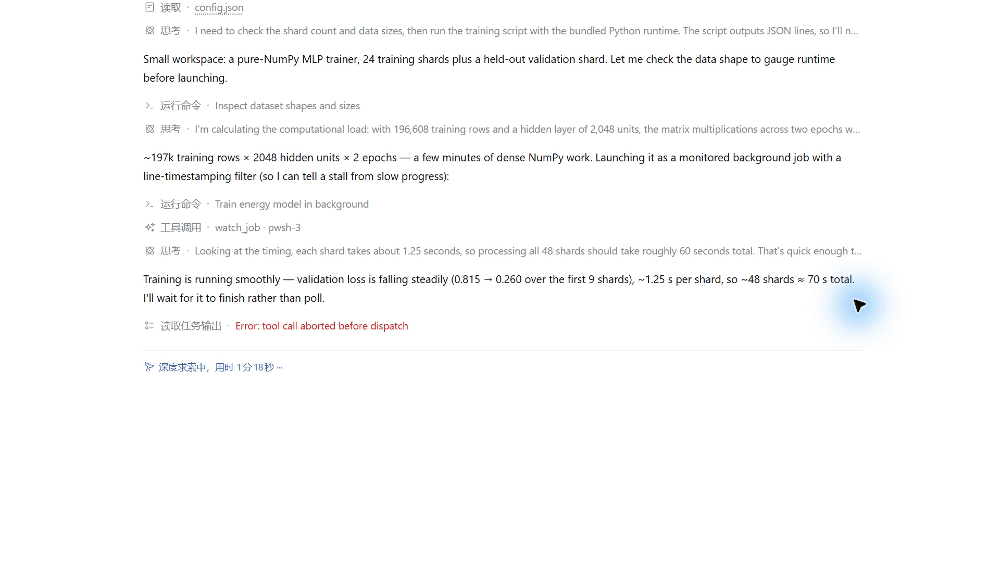

# dsh-run-watchdog

[English](README.md) | 简体中文

结合任务目的和运行日志，判断长任务是否值得继续等待，发现异常时提醒主 Agent。

适用于 DeepSeek Harness 的训练、构建、测试和数据处理任务。支持 **DeepSeek / Jev**，版本 **0.1.0**。

## 演示



训练出现 NaN，watchdog 及时提醒 Agent。

## 安装

### Desktop：通过 GitHub 安装

打开 **插件 → 添加插件**，粘贴仓库地址，点击 **安装 → 立即启用**：

```text
https://github.com/Hirate99/dsh-run-watchdog
```

在 **插件 → dsh-run-watchdog** 中配置。仓库已包含构建产物，安装时不执行构建脚本，也不需要添加构建白名单。CI 会检查提交的产物与源码一致。

也可使用 [v0.1.0 安装包](https://github.com/Hirate99/dsh-run-watchdog/releases/download/v0.1.0/dsh-run-watchdog-0.1.0.tgz)。Release 安装包是固定快照，仓库地址跟随默认分支。

### 从源码构建

需要 Node.js ≥ 22.19，以及提供后台任务接口的 DSH `bash` / `pwsh` 工具。

```sh
npm ci
npm run check
npm pack
```

在 Desktop 的插件页面安装生成的 `dsh-run-watchdog-0.1.0.tgz` 并启用。也可在完全退出 Desktop 后使用其自带 CLI：

```powershell
& "$env:LOCALAPPDATA/Programs/DeepSeek Harness/resources/runtime/cli/bin/dsh.cmd" plugin --profile desktop add "<包的绝对路径>/dsh-run-watchdog-0.1.0.tgz"
```

重新打开 Desktop，在 **插件 → dsh-run-watchdog** 中配置。仓库尚未发布到 npm。

开发依赖锁定 DSH `0.2.1-alpha.3`、Cordis `4.0.5-alpha.2`。此前验证过 Desktop `0.2.0-rc.2` 的内置运行时；升级宿主后应重跑集成测试。

## 配置

- **DeepSeek**：默认复用 DSH 模型设置中的 API Key，在插件配置页选择模型。
- **Jev**：选择 Jev 后填写专用 API Key，保存到 DSH 凭据存储。
- **观察模式**：默认模式，只判断，不提醒或停止任务。配置 `recordPath` 可保存判断记录。
- **执行模式**：异常投递给原会话，空闲的 Agent 会被唤醒。

保存后可点击“测试连接”。高级设置对新附加的监测生效。

| 配置 | 默认值 | 含义 |
| --- | --- | --- |
| `firstCheckMs` | 10000 | 首次检查等待时间 |
| `judgeTimeoutMs` | 8000 | 单次模型请求超时 |
| `stopThreshold` | 0.8 | Jev 自动停止概率阈值 |
| `allowAutoStop` | false | 是否允许任务申请自动停止 |
| `recordPath` | 未设置 | 本地 JSONL 记录路径 |
| `recordAfterMs` | 3600000 | 提醒后继续纯观察的时长，仅开启记录时生效 |

模型请求包含任务目的、命令和最多 16000 字符的近期日志；本地记录也包含这些内容。密钥优先从 DSH 凭据存储读取，其次读取 `apiKeyEnv` 指定的环境变量。

## 工作方式

插件向主 Agent 提供使用说明。Agent 用原生工具启动后台任务，再调用 `watch_job` 附加监测；用户无需指定工具或填写参数。

`watch_job` 立即返回。多个任务并发监测，各自使用独立日志游标，不消耗 Agent 的输出。Agent 可继续用 `job_output` 读取日志。插件不启动或重启命令。

模型可以选择 10、30、60、120、300、600 秒后复查，或者提醒、建议停止、表示不确定：

- Jev 的停止概率达到阈值，且部署配置与本次任务都授权自动停止，才执行停止；否则转为提醒。
- 首选为提醒或停止，或两者概率之和达到 0.4 时，提醒 Agent。
- 继续等待的概率合计与“不确定”比较，再选择概率最高的检查间隔。
- DeepSeek 没有概率输出，停止建议只会转为提醒。

每个监测最多提醒一次。正常结束使用 DSH 原生通知。提醒会取消同一会话中的 `job_output(wait=true)` 等待，包括提醒尚未送达时新发起的等待；不会因此停止后台任务或取消整个 Agent。其他阻塞工具不在此处理范围内。

任务完成或插件卸载时清理监测，卸载不终止任务。插件重启后不会自动恢复旧监测。模型请求失败时按默认间隔重试。

## 开发与测试

```sh
npm run check
```

执行构建、类型检查及离线回归，无需 API Key。覆盖决策阈值、日志分块与截断、状态不可变性、调度边界、后台记录、并发监测、等待中断竞态、DSH 工具与真实子进程集成。

在线连接测试会调用所选服务：

```sh
npm run smoke -- jev
npm run smoke -- deepseek
```

`WATCHDOG_MODEL` 可覆盖测试模型。离线测试通过不代表所有真实任务的判断质量；演示也不代表 Agent 在每个任务中都能稳定选择监测工具。

| 文件 | 职责 |
| --- | --- |
| `src/output.ts` | 日志状态与证据统计，纯函数 |
| `src/decision.ts` | 模型输入、动作判断和比较规则 |
| `src/monitor-state.ts` | 检查快照与时间调度，纯函数 |
| `src/monitor.ts` | 读取日志、请求模型、执行监测循环 |
| `src/jobs.ts` | DSH 任务读取与独立游标 |
| `src/interrupt-wait.ts` | 提醒到达时释放输出等待 |
| `src/index.ts` | 工具注册、提醒投递和 Cordis 生命周期 |
| `src/providers.ts` | DeepSeek / Jev 请求适配 |
| `src/settings.ts`、`src/client.tsx` | 凭据、连接测试与配置界面 |

`docs/` 和 `.integration/` 用于本地验证记录，不纳入版本控制；README 演示素材保存在 `assets/`。

## CI 与发布

推送 main 或创建 PR 时，GitHub Actions 使用 Node.js 24 在 Windows 和 Linux 上运行完整检查，并分别上传可安装的 `.tgz` 产物。测试使用本地样例，无需 API 密钥。

发布时推送与 package.json 一致的标签（当前为 v0.1.0）。两个平台都通过后，工作流才创建 GitHub Release 并上传安装包。使用内置 GitHub Token，不需要 npm Token；不会自动覆盖已有 Release。
